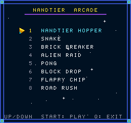
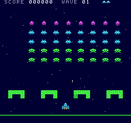
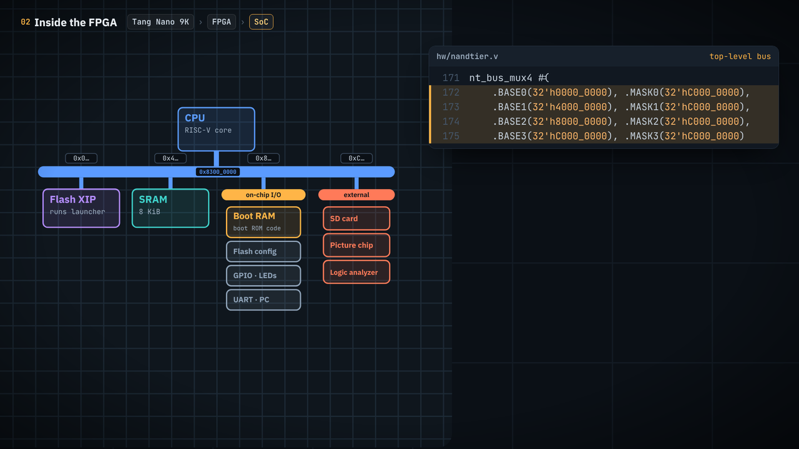

<p align="center"></p>
<p align="center"><sub>Real hardware: a $25 Tang Nano 9K, an HDMI screen, and the PC keyboard as the controller.</sub></p>

<p align="center">
  <a href="https://github.com/NandTier/nandtier/actions/workflows/ci.yml"></a>
  <a href="LICENSE"></a>
  <a href="https://github.com/NandTier/nandtier/releases/latest"></a>
  
  
  
</p>

# NandTier

**A complete RISC-V computer for small FPGA boards, small enough to read in a weekend.** It has its own CPU, a boot ROM, execute-in-place flash, an HDMI picture processor, an SD card, and eight games, built with open-source tools from one `make`.

It runs on the Sipeed Tang Nano 9K (Gowin GW1NR-9C, about $25), the Sipeed Tang Nano 20K (Gowin GW2AR-18C) and the Radiona ULX3S (Lattice ECP5).

<p align="center"> &nbsp; </p>

- **CPU:** RV32IM, with hardware multiply and divide, written from scratch in readable Verilog.
- **Program storage:** execute-in-place from the SPI flash, with a 4 KiB read cache, and a boot ROM that programs the flash over the UART. No programmer hardware needed.
- **I/O:** GPIO and a UART.
- **HDMI output:** an NES-style picture processing unit (tiles, sprites, scrolling, palettes) and an 80x25 text terminal on top.
- **SD card:** an SPI interface. The card holds the game cartridges.
- **Games:** eight games on the SD card, started from a game menu on the HDMI screen and played with the PC keyboard over the UART: NandTier Hopper (a platformer), Snake, Brick Breaker, Alien Raid, Pong, Block Drop, Flappy Chip and Road Rush.
- **Tested:** a simulation and host test suite, from single CPU modules to random programs checked against an instruction-set simulator, runs on every push.

All NandTier sources are licensed under the [Apache License 2.0](LICENSE). See [NOTICE](NOTICE) for the vendor files that are not.

## Quick Start

No FPGA tools yet? Download `nandtier-tangnano9k.fs` from the [latest release](https://github.com/NandTier/nandtier/releases/latest) and load it with `openFPGALoader -b tangnano9k nandtier-tangnano9k.fs`. To build everything yourself:

```bash
git clone https://github.com/NandTier/nandtier.git && cd nandtier
setup/setup.sh                       # every tool, into tools/ (Windows: setup\setup.bat)
make && make test                    # firmware, games, and the test suite
make fpga && make fpga-load          # the bitstream, into the Tang Nano 9K
make program COMx=/dev/ttyUSB1       # launcher into the flash, games onto the SD card
python3 sw/gamepad.py /dev/ttyUSB1   # play: the PC keyboard is the controller
```

## Contents

- [Setting Up](#setting-up)
- [Project Structure](#project-structure)
- [Hardware](#hardware): clocks, CPU, address map, HDMI, resources, boards
- [Firmware](#firmware): build, boot ROM and flash programming, user firmware
- [Games](#games): how they work, playing, writing your own
- [Testing](#testing)
- [Known Issues](#known-issues)
- [Contributing](#contributing)
- [License](#license)

<p align="center"></p>

## Setting Up

One script downloads and installs every tool the project needs, on Linux, macOS, Windows, or Windows with WSL. Everything goes into `tools/` inside this folder: nothing is installed system-wide, no administrator rights are needed, and deleting `tools/` and `local.mk` uninstalls it.

| Tool | Version | What it is for |
|------|---------|----------------|
| [OSS CAD Suite](https://github.com/YosysHQ/oss-cad-suite-build) | 2026-11-01 | Yosys, nextpnr, Apicula, openFPGALoader, Icarus Verilog, GTKWave |
| [xPack RISC-V GCC](https://github.com/xpack-dev-tools/riscv-none-elf-gcc-xpack) | 14.2.0-3 | the firmware and the games |
| pyserial | 3.5 | `sw/nandtier-programmer.py`, `sw/gamepad.py` |
| [xPack Windows Build Tools](https://github.com/xpack-dev-tools/windows-build-tools-xpack) | 4.4.1-3 | Windows only: GNU make and a shell |

The versions are pinned in `setup/versions.txt`, so every student gets the same tools.

**Linux and macOS** (and Ubuntu under WSL):

```bash
setup/setup.sh          # about 1 GB of downloads, 4 GB on disk
```

**Windows:** double-click `setup\setup.bat`, or run it in a terminal. Then, in each new PowerShell window, load the tools with `. .\env.ps1` (or `env.bat` in cmd) before running `make`.

The script then:

1. Downloads each archive once into `setup/cache/`, checking the published SHA-256 where there is one.
2. Unpacks it into `tools/`.
3. Writes `local.mk`, which every Makefile reads, so plain `make` finds the tools. It also writes `env.sh`, `env.ps1` and `env.bat`, which put the tools on `PATH` in your own shell.
4. On Linux, asks whether to install USB rules for the boards (`/etc/udev/rules.d/99-nandtier.rules`, needs sudo), so `openFPGALoader` and the UART work without sudo.
5. Checks every tool and builds the firmware.

Run it again at any time: it only does what is missing.

### Without Internet

The tools come from GitHub and PyPI only once. After that, nothing in the project needs the network.

```bash
setup/setup.sh --download-only                        # fill setup/cache/ (about 1 GB), install nothing
setup/setup.sh --offline                              # install from setup/cache/, never touch the network
setup/setup.sh --bundle                               # repository + cache in one archive, for this OS
setup/setup.sh --bundle --platform win32-x64          # the same for Windows PCs (also: linux-arm64, darwin-arm64, ...)
```

For a classroom, one machine with internet makes the bundle. The others unpack it and run `setup/setup.sh --offline`, or `setup\setup.bat -Offline` on Windows.

Other options: `--no-cad` (firmware only), `--no-gcc` (bitstreams only), `--gcc <dir>` (use an installed toolchain), `--prefix <dir>`, `--check`. `setup/setup.sh --help` lists them all.

### Notes

- **An existing toolchain:** `local.mk` is a plain Makefile fragment, so you can edit it by hand, e.g. `RISCV_PATH ?= /opt/xpack-riscv-none-embed-gcc-8.2.0` with `RISCV_NAME ?= riscv-none-embed`. A value given on the `make` command line always wins.
- **GCC versions:** the Makefiles ask the compiler whether it knows the `Zicsr` extension name (GCC 12 and later need it for `rdcycle`), so both the old `riscv-none-embed` 8.x and current compilers work.
- **Windows USB driver:** `openFPGALoader` needs the WinUSB driver on the board's JTAG interface (interface 0). Install it once with [Zadig](https://zadig.akeo.ie/) and leave interface 1 alone, because it is the UART (`COMx=COM5`, say). The Gowin IDE's programmer is the alternative.
- **WSL:** the board's USB has to be passed to Linux with [usbipd-win](https://github.com/dorssel/usbipd-win) (`usbipd attach --wsl --busid <id>`). Building and simulating need nothing extra.
- **Gowin IDE:** the vendor flow (`project/`) and the SoC simulation's primitive models (`GOWIN_HOME`) come from the Gowin IDE, which needs a free licence from Gowin and is not downloaded by the script.

After setup:

```bash
make                                 # boot ROM, launcher and games
make fpga                            # the bitstream, with the open-source tools
make fpga-load                       # into the FPGA (until power-off)
make program COMx=/dev/ttyUSB1       # launcher into the flash, games onto the SD card
python3 sw/gamepad.py /dev/ttyUSB1   # play: the PC keyboard is the controller
make test                            # the test suite
```

The course **Gates to Games** follows this repository from the first logic gate to the games, with a voiced film for every lesson.

## Project Structure

```text
nandtier/
├── hw/                       FPGA design (Verilog)
│   ├── nandtier.v              SoC top level
│   ├── nandtier_core.v         CPU core top level
│   ├── core/                   CPU stages: fetch, decode, execute, ALU, ...
│   ├── bus/                    address decoder
│   ├── mem/                    boot RAM and SRAM
│   ├── periph/                 UART, GPIO, SPI flash + read cache, SD SPI, ILA/JTAG, reset
│   └── video/                  HDMI: timing, PPU, text terminal, font, TMDS
├── fw/                       firmware (C, RISC-V GCC)
│   ├── include/nandtier.h      register map, memory map, cartridge slot; shared by all images
│   ├── common/                 SD card driver, start-up code, shared
│   ├── fw-brom/                boot ROM: starts the firmware, flash programmer
│   ├── fw-flash/               user firmware ("launcher"): menus, game loader; runs from the SPI flash
│   ├── sdk/                    game SDK: ngame library, art tool, cartridge build rules
│   └── games/                  the game cartridges, one directory each, and the SD pack
├── sw/                       host tools: flash programmer, cartridge packer, keyboard controller
├── setup/                    one-step install of every tool (setup.sh, setup.bat), offline cache
├── sim/                      whole-SoC simulation, SPI flash and SD card models
├── test/                     test suite (CPU, peripherals, video, games, loader, tools)
├── boards/                   per board: top level (clocks, pins), constraints, settings
├── oss/                      bitstream with open-source tools (Yosys, nextpnr, Apicula, Trellis)
├── project/                  Gowin IDE project, constraints
└── gowin_ip/                 Gowin IP (PLL, clock divider, RAMs)
```

## Hardware

### Clocks

```text
27 MHz crystal -> rPLL 124.875 MHz (HDMI bit clock / 2) -> CLKDIV /5 -> 24.975 MHz
```

The 24.975 MHz clock drives the CPU, the bus and the 640x480 pixel output (59.46 Hz: 800 × 525 = 420,000 cycles per frame). Firmware uses `NT_CLK_HZ` from `fw/include/nandtier.h`.

### CPU Core

`nandtier_core` is a multi-cycle RV32IM core. One instruction at a time goes through the stage modules in `hw/core/`:

| Stage   | Module       | Work |
|---------|--------------|------|
| FETCH   | `nt_fetch`   | PC and instruction register |
| DECODE  | `nt_decode`  | decode, register file read (`nt_regfile`), ID/EX stage register |
| EXECUTE | `nt_execute` | ALU (`nt_alu`), branch compare (`nt_branch`), address/target adder; multiply/divide (`nt_muldiv`) |
| MEM     | `nt_lsu`     | load/store alignment and the bus access (loads/stores only) |
| WB      |              | register write: end of EXECUTE, or a WB cycle for loads |

- **Sequencing:** `nt_control` is the state machine: BOOT → FETCH → DECODE → EXECUTE → (MEM → WB) → FETCH, or → TRAP. `nt_bus` drives the memory port, and `nt_csr` holds the read-only `cycle`/`time`/`instret` counters.
- **Speed:** an instruction takes 4 cycles, or 7 for loads and stores, when memory answers one cycle after `mem_valid`. Slower memory adds wait cycles. A multiply takes 5 cycles (one 33 x 33 product in the FPGA's DSP blocks covers all four MUL variants), a divide 38 (one bit per cycle).
- **Reset vector:** `0x8000_0000` (boot ROM).
- **Supported:** RV32I, the M extension (MUL, MULH, MULHSU, MULHU, DIV, DIVU, REM, REMU, with the specification's results for division by zero and overflow), FENCE/FENCE.I (no-ops), counter reads (`rdcycle[h]`, `rdtime[h]`, `rdinstret[h]`).
- **Not supported:** interrupts, the C extension, machine-mode traps.
- **Firmware:** it's built for `rv32i`, so it also runs on older bitstreams without the M extension.
- **Traps:** illegal instructions, ECALL/EBREAK, misaligned loads, stores and jump targets, and writes to the counters raise `trap` and halt the core until reset. The on-chip logic analyzer records the trap signal.

Bus protocol, followed by every slave: `mem_valid` stays high until `mem_ready`, with address and data held stable. `mem_addr` is word aligned, `mem_wstrb` is zero for reads, and `mem_instr` marks instruction fetches. After every transfer `mem_valid` is low for at least one cycle.

### Address Map

| Address | Size | Device |
|---------|------|--------|
| `0x0000_0000` | 8 MiB | SPI flash, execute in place, through a 4 KiB read cache (user firmware) |
| `0x4000_0000` | 8 KiB | SRAM |
| `0x8000_0000` | 8 KiB | boot RAM (boot ROM image, reset vector) |
| `0x8100_0000` | 4 B   | SPI flash config / bit-bang register |
| `0x8200_0000` | 12 B  | GPIO |
| `0x8300_0000` | 8 B   | UART |
| `0xC000_0000` | 16 B  | SD card SPI port |
| `0xC100_0000` | 24 KiB | picture processing unit (PPU) |
| `0xC200_0000` | 64 B   | on-chip logic analyzer (CPU bus trace) |

Accesses to unmapped addresses complete at once and read 0. Register details are in `fw/include/nandtier.h` and in the header comment of each module in `hw/periph/`.

**UART** (`nt_uart`): 8N1.
- `+0x0` DATA: a read returns the oldest of up to 16 received bytes, or `0xFFFF_FFFF` if there is none. A write sends a byte; the bus waits while the previous byte is still being sent.
- `+0x4` DIV: the bit period in clock cycles (217 for 115200 baud). Every byte written to DATA also appears on the HDMI terminal.

**GPIO** (`nt_gpio`): `+0x0` OUT, `+0x4` IN, `+0x8` OE (1 = drive), for 7 pins. Pins 0-5 are the LEDs (active low).

**SPI flash** (`nt_spi_flash`), config register at `0x8100_0000`:

| Bits | Field | Meaning |
|------|-------|---------|
| 31   | XIP_EN | 1: memory-mapped reads (reset), 0: bit-bang |
| 22   | DUAL   | dual I/O reads (`BBh`) instead of `03h` |
| 20   | CRM    | continuous read mode, with DUAL: no command byte between reads |
| 9:8  | OE     | bit-bang output enables for IO1, IO0 |
| 5, 4 | CSB, CLK | bit-bang chip select and clock |
| 1:0  | DO / DI | bit-bang IO1, IO0: write = output, read = pin |

- **Read buffering:** the controller keeps one word and reads the next one ahead, so straight-line code streams from the flash without new commands.
- **Mode changes:** writing DUAL or CRM re-initialises the flash: it sends `FFh FFh` (leave continuous mode) and `ABh` (wake-up), then waits. The instruction fetch that follows simply waits for this.
- **Switching to bit-bang:** clearing XIP_EN first takes the flash out of continuous read mode, and only then hands the pins to the bit-bang bits; config accesses wait meanwhile. Software therefore never sees the flash in a state it did not expect.

**SD card SPI port** (`nt_sd_spi`), SPI mode 0:
- `+0x0` TX: a write starts a byte transfer.
- `+0x4` RX: the received byte.
- `+0x8` CTRL: bit 0 SCK, bit 1 MOSI, bit 2 CS (pin levels when no transfer runs); bit 3 MISO and bit 4 busy are read-only.
- `+0xC` DIV: the SCK half period in cycles. The SD driver uses 32 (~390 kHz) to initialise the card, then 6 (~2 MHz).

**Flash read cache** (`nt_flash_cache`): 4 KiB, direct mapped, 16-byte lines, between the bus and the flash controller. A hit answers like the SRAM, one cycle after the request. A miss reads the whole line from the flash. The cache empties itself whenever the flash controller re-initialises, for example after the boot ROM programmed the flash, so it never returns stale code.

**On-chip logic analyzer** (`nt_ila`, at `0xC200_0000`): captures 128 consecutive CPU bus clock samples in a circular buffer. Its 64-bit data record contains the bus address and the read or write data; a separate flags field contains ready, valid, write strobes, instruction-fetch, and trap. It is controlled and read by the CPU through memory-mapped registers, so the same analyzer works on all supported boards without extra pins.

| Offset | Register | Meaning |
|--------|----------|---------|
| `0x00` | CTRL / STATUS | Write bit 0 to arm; write bit 1 too to enable the address trigger. Read bit 0 armed, bit 1 done, bit 2 triggered, bits 15:8 captured sample count. |
| `0x04` | TRIGGER_ADDR | Address value to compare against accepted bus transactions. |
| `0x08` | TRIGGER_MASK | Address compare mask; masked bits must match. |
| `0x0C` | POST_COUNT | Number of samples to capture after the matching transaction (0-255). |
| `0x10` | READ_INDEX | Chronological sample index, 0-127. |
| `0x14` | SAMPLE0 | Bus address. |
| `0x18` | SAMPLE1 | Transaction data: write data for writes, read data otherwise. |
| `0x1C` | SAMPLE2 | Flags: bit 0 ready, bit 1 valid, bits 5:2 write strobes, bit 6 instruction fetch, bit 7 CPU trap. |

With the address trigger enabled, capture runs continuously until the first matching valid-and-ready bus transaction, then captures `POST_COUNT` additional clock samples and stops. The circular buffer retains the latest 128 samples, including activity before the trigger. With the trigger disabled, capture stops when it has collected 128 samples. Write `ILA_READ_INDEX` then read `ILA_SAMPLE0` through `ILA_SAMPLE2` for each record; sample reads take one extra bus cycle, and the count in STATUS indicates how many entries are valid.

**ULX3S JTAG access:** the ECP5 top level connects the device's internal JTAG user chain to the ILA, so no extra board pins are needed. Select the ECP5 ER1 user instruction (`0x32`) and scan a 64-bit request:

| Bits | Field | Meaning |
|------|-------|---------|
| 63:60 | OP | `1` write an ILA register, `2` read an ILA register, `0` no-op/poll |
| 59:52 | ADDR | byte offset in the ILA register window |
| 51:44 | SEQ | request sequence number, echoed in the response |
| 43:32 | Reserved | write zero |
| 31:0 | DATA | register write data |

After updating the request, clock the TAP in Run-Test/Idle, then scan a no-op frame to collect its response. Response bits 63:60 are status (`0` success, `2` invalid request), bits 59:52 echo SEQ, and bits 31:0 contain read data. The helper script polls for the matching sequence and supports the ILA commands below as well as the CPU debug commands described next. For example, after configuring an OpenOCD JTAG adapter and creating an 8-bit ECP5 tap named `ecp5.tap`:

```text
source sw/ila_jtag.tcl
nt_ila_dump
```

The same user-chain bridge provides project-specific CPU debug registers at offsets `0x80`-`0x90`:

| Offset | Register | Meaning |
|--------|----------|---------|
| `0x80` | CONTROL / STATUS | Write `1` to request halt, `2` to resume, or `4` to execute one instruction and halt. Read bit 0 halted, bit 1 trap, bit 2 halt requested. |
| `0x84` | PC | Read or write the program counter while halted; writes must be word-aligned. |
| `0x88` | GPR_SELECT | Select a register index from 0 to 31. |
| `0x8C` | GPR_DATA | Read or write the selected integer register while halted. x0 always reads as zero and ignores writes. |
| `0x90` | SYSTEM_RESET | Write bit 0 to assert or release system reset. The debug transport remains active so reset can be released over JTAG. |

Example OpenOCD Tcl console commands:

```text
source sw/ila_jtag.tcl
nt_cpu_halt
nt_cpu_pc
nt_cpu_gpr_read 1
nt_cpu_step
nt_cpu_resume
```

This is custom project-specific debug access over the ECP5 user chain, not a RISC-V Debug Module/DTM. OpenOCD can run the Tcl commands, but its standard RISC-V target and GDB integration are not supported. The adapter configuration depends on the JTAG probe. CPU register and PC access requires a halted core; a trapped core can be inspected but cannot resume without reset. Tang Nano Gowin JTAG support is also not included yet.

### HDMI Output

`hw/video/nt_video.v` produces 640x480 DVI over the HDMI connector. The TMDS encoding follows DVI 1.0. Each lane, the clock lane included, goes through a Gowin OSER10 and an ELVDS_OBUF.

**Picture processing unit** (`nt_ppu`, at `0xC100_0000`): an NES-style tile and sprite engine. The picture is 256 x 240 pixels, shown at 2x in the middle of the screen.

| Offset | Contents |
|--------|----------|
| `0x0000` | CTRL: bit 0 background on, bit 1 sprites on, bit 2 text terminal on (reset: terminal only) |
| `0x0004` / `0x0008` | SCROLL_X (0-511) / SCROLL_Y (0-255) |
| `0x000C` | SPLIT: lines above it are not scrolled (a fixed status bar) |
| `0x0010` | STATUS (read): bit 0 vertical blank, bits 31:16 frame counter |
| `0x0400` | palette: 128 colours, 12-bit `0xRGB`; 0-63 background palettes 0-3, 64-127 sprite palettes 0-3 |
| `0x0800` | OAM: 64 sprites |
| `0x2000` | tile map: 64 x 32 tiles (two screens wide), entry = tile, palette, flips |
| `0x4000` | CHR: 256 tiles of 8 x 8 pixels at 4 bits per pixel |

- **Background:** a scrolling 64 x 32 tile map. Each entry picks a tile, one of 4 background palettes, and horizontal/vertical flips.
- **Sprites:** 64 of them, 8x8 or 16x16 (tiles t, t+1, t+16, t+17), with palette, flips and a behind-the-background flag. Up to 16 per line; a lower OAM index is in front.
- **Colours:** colour 0 of a tile is transparent; palette entry 0 is the backdrop.
- **Memory access:** video memory is write only. Writes take effect at once; games update sprites and scroll in the vertical blank.

Exact bit layouts are in the header comment of `nt_ppu.v` and as macros (`PPU_*`, `NT_ENTRY`, `OAM_ENTRY`) in `fw/include/nandtier.h`. Internally, each picture line is drawn into a line buffer while the previous line is shown. That gives 1600 cycles per line, and a line with 16 large sprites needs about 820.

**Text terminal** (`nt_text_term`): an 80 x 25 screen in white over the picture, starting at line 40. PPU CTRL bit 2 switches it on and off.
- **Font:** 8 x 16 cells. The glyphs are drawn on a 5 x 8 grid in `hw/video/gen_font.py`, which generates `nt_font_rom.v`.
- **Printable characters:** 0x20-0x7E print at the cursor, and lines wrap at column 80.
- **Control characters:** LF starts a new line (scrolling at the bottom), CR returns to column 0, BS erases the character before the cursor, TAB moves to the next multiple of 8, and FF or EOT clears the screen.

### FPGA Resources

Gowin IDE synthesis and place-and-route of the whole SoC (GW1NR-9C,
Gowin V1.9.9.03 Education):

| Resource | Used |
|----------|------|
| Logic | 5213 / 8640 (61%; 4418 LUTs, 567 ALUs) |
| Registers | 2527 / 6693 (38%) |
| CLS (configurable logic slices) | 3606 / 4320 (84%) |
| Block RAM | 26 / 26 (100%) |
| DSP | 1 MULT36X36 (20%) |
| PLL | 1 / 2 (50%) |

The place-and-route report lists the 26 block RAMs as 8 SP, 16 SDPB and
2 pROM. Block RAM is fully occupied in this Gowin build.

### Boards and Open-Source Builds

| Board | FPGA | Clock in | HDMI | Firmware in flash at | `BOARD=` |
|-------|------|----------|------|----------------------|----------|
| Sipeed Tang Nano 9K | Gowin GW1NR-9C | 27 MHz | emulated LVDS | `0x000000` (bitstream is inside the FPGA) | `tangnano9k` (default) |
| Sipeed Tang Nano 20K | Gowin GW2AR-18C | 27 MHz | true LVDS | `0x100000` (bitstream at 0) | `tangnano20k` |
| Radiona ULX3S 12F/25F/45F/85F | Lattice ECP5 | 25 MHz | GPDI, pseudo-differential | `0x200000` (bitstream at 0) | `ulx3s` (`ULX3S_SIZE=85`; ILA over JTAG) |

The bitstreams are built with open-source tools only:

- **Gowin boards:** Yosys → nextpnr-himbaechel → Apicula's `gowin_pack`.
- **ECP5:** Yosys → nextpnr-ecp5 → Trellis's `ecppack`.
- **Programming:** openFPGALoader.

All of these come in the [YosysHQ OSS CAD Suite](https://github.com/YosysHQ/oss-cad-suite-build/releases), which `setup/setup.sh` installs to `tools/oss-cad-suite` (see [Setting Up](#setting-up)). To use other copies, pass `OSS_CAD=<dir>`, or `OSS_CAD=` to take them from `PATH`.

```bash
make fpga BOARD=tangnano20k          # oss/build/tangnano20k/nandtier.fs   (about 1.5 minutes)
make fpga-load BOARD=tangnano20k     # into the FPGA: gone at power-off, good for trying
make fpga-flash BOARD=tangnano20k    # into the configuration flash: stays
make program BOARD=tangnano20k COMx=/dev/ttyUSB1   # launcher at the board's flash offset + games
make -C oss boards                   # every board
```

Everything except the bitstream is shared between the boards: the boot ROM, the launcher, the games and the SD card pack.

- **Flash offset in hardware:** on boards whose bitstream sits at the start of the SPI flash, `nandtier_soc` maps CPU address 0 to the flash from `FLASH_OFFSET` on.
- **Programmer:** `make program BOARD=...` writes the launcher at that offset.
- **Launcher:** finds the offset itself by looking for its own first bytes, then writes games to the offset plus 1 MiB.
- **Bitstream writes:** `fpga-flash` writes only the bitstream, so the launcher and the games above it stay.

How the sources are split:

- **`hw/nandtier.v`:** `nandtier_soc` is the whole system for any board. It has parameters for the flash offset, GPIO polarity (the ULX3S LEDs light on 1) and Gowin true or emulated LVDS. The same file keeps `nandtier`, the Tang Nano 9K top level, so the Gowin IDE project builds unchanged.
- **`boards/<board>/`:** the board's top level (PLL, reset button, pin details), its constraints, and `board.mk` with the device and settings.
- **`boards/common/`:**
  - `nt_rams.v` replaces the Gowin RAM IP with portable Verilog. The boot RAM loads the boot ROM from `fw/fw-brom/build` at synthesis, so no `make bootram` is needed.
  - `ecp5_hdmi_phy.v` is the HDMI output for ECP5: 10:1 shift registers at 125 MHz with DDR outputs.
- **No vendor files:** the open flow reads none of the Gowin files.

Results (nextpnr):

| Board | Logic | Block RAM | Max clk_sys (needs ~25 MHz) |
|-------|-------|-----------|-----------------------------|
| Tang Nano 9K | 5621 / 8640 LUT4 (65%) | 24 / 26 | 42.9 MHz |
| Tang Nano 20K | 5604 / 20736 LUT4 (27%) | 24 / 46 | 82.2 MHz |
| ULX3S 85F | 5038 / 83640 LUT4 (6%) | 24 / 208 DP16KD | 57.5 MHz (shift clock: 252 MHz, needs 125) |

`make -C oss gatesim BOARD=tangnano9k` (or `tangnano20k`) simulates the synthesized netlist with Gowin's own primitive models (`GOWIN_HOME`, as for `sim/`). This checks the Yosys mapping independently. The test pings the boot ROM over the UART at 115200 baud, programs a flash page through it, and measures the HDMI clock pair. Only the PLL and the clock divider use stand-ins (`oss/sim_clocks.v`), because Gowin's rPLL model produces no clock under Icarus Verilog.

**Adding a board:** copy the closest `boards/<board>/`, then change:

- **Top level:** the PLL (about 25 MHz `clk_sys` and 5x for HDMI), the reset polarity and the pins.
- **`FLASH_OFFSET`:** above the end of the bitstream, on a 1 MiB boundary.

Then add the board to `BOARDS` in `oss/Makefile`.

## Firmware

### Dependencies

- Python 3.6 or newer, with pyserial for the programmer.
- RISC-V GCC. `setup/setup.sh` installs xPack `riscv-none-elf-gcc` into `tools/riscv-gcc` and points the Makefiles at it through `local.mk`. For another toolchain set `RISCV_PATH` (toolchain root) and `RISCV_NAME` (prefix), in `local.mk` or on the command line.

### Build

```bash
make            # everything below
make brom       # boot ROM     -> fw/fw-brom/build/  (fw-brom_0..3.mi for the boot RAM)
make flash      # launcher     -> fw/fw-flash/build/ (fw-flash.v for the programmer)
make games      # games        -> fw/games/*/build/<game>.bin, packed into fw/games/build/carts.img
```

Everything is built with `-march=rv32i` (`rv32i_zicsr` with GCC 12 and later). Shared build rules are in `fw/common.mk`.

### Boot ROM and Flash Programming

After reset the boot ROM listens on the UART (115200 baud) for half a second. If the programmer sends `0x55`, it answers `0x56` and serves programmer commands. Otherwise it jumps to the firmware at `0x0000_0000`.

```bash
make program COMx=/dev/ttyUSB1                                  # launcher into the flash + games onto the SD card
make program COMx=/dev/ttyUSB1 CARTS=                           # launcher only (leave the SD card alone)
make program-games COMx=/dev/ttyUSB1                            # games only
make program COMx=/dev/ttyUSB1 PROG_FILE=<objcopy verilog file> # program another image
```

Start the command, then press the reset button (**S1**); the programmer keeps pinging for 10 seconds.

The protocol is documented at the top of `fw/fw-brom/isp.c`:

| Host sends | Reply | Action |
|------------|-------|--------|
| `55` | `56` | ping |
| `10 n d0..dn` | `11`, checksum | fill the page buffer (n+1 bytes) |
| `30 a2 a1 a0` | `31` ... `32` | erase the 4 KiB sector |
| `40 a2 a1 a0` | `41` ... `42` | program the page buffer |
| `60` | `61`, status [r7] | initialise the SD card |
| `62 b3..b0 d0..d511 sum` | `63`, result | write one SD block (0 ok, 1 failed, 2 checksum) |
| `F0` | `F1` | restart the boot ROM |

**Boot ROM service for the firmware:** `0x8000_0054` is a fixed entry point to `flash_io(buf, len, wren)`. It runs one SPI flash command with XIP off, from boot RAM; the firmware uses it to read the flash ID (`nt_flash_io` in `nandtier.h`). The boot ROM is built without gp-relative addressing, so the routine works with the firmware's gp.

### Updating the Boot ROM in the FPGA

The boot ROM is the initial content of the boot RAM, so it lives in the bitstream:

```bash
make bootram    # builds the boot ROM and writes it into project/src/gowin_sp/bootram_2kx8_0..3.v
```

Then rebuild the bitstream in the Gowin IDE (`project/nandtier.gprj`) and program the FPGA. The boot ROM uses about 2.6 KiB of the 8 KiB.

> The boot RAM files in `project/src/gowin_sp` hold the boot ROM built from this release. Run `make bootram` again after you change `fw/fw-brom`.

### Writing an Image to the SD Card

The programmer can also write raw SD blocks, buffered in SRAM by the boot ROM:

```bash
make program COMx=/dev/ttyUSB1 SD_IMAGE=picture.hex SD_START_BLOCK=2048
make program COMx=/dev/ttyUSB1 SD_IMAGE=picture.hex SD_START_BLOCK=2048 SD_MAX_SECTORS=1   # quick test
```

- **Image file:** a raw binary file, or a Gowin 4-bit memory file (`.hex`), whose pixels are packed two per byte, high nibble first. 61,440 pixels make 60 blocks.
- **Placement:** blocks are written raw, starting at block 2048 by default; block 0 normally holds the partition table. The image is not a file in the card's filesystem.

SD initialisation status codes (from `fw/common/sd.h`): `0x00` success, `0x1n` CMD0 failed, `0x2n` CMD8 failed, `0x30` CMD8 echo wrong (the two echo bytes follow), `0x4n` CMD55 failed, `0x05` ACMD41 timed out, `0x6n` CMD16 failed.

### User Firmware

The firmware shows a menu on the UART (115200 baud) and on the HDMI terminal:

| Key | Action |
|-----|--------|
| `1`-`6` | toggle LED 1-6 |
| `F` / `I` | show the flash read mode / read the flash JEDEC ID |
| `S` / `D` / `C` | single, dual I/O, or dual I/O + continuous read mode |
| `B` / `A` | benchmark (cycles, instructions, CPI, self-check) / benchmark every flash mode |
| `G` | tic-tac-toe for two players |
| `T` / `R` / `W` | initialise the SD card / read test block 1024 / write and verify it |
| `P` | game menu on the HDMI screen (see Games) |
| `M` | about |

## Games

### How It Works

The games are not part of the firmware in the flash. Each game is a separate program, a *cartridge*, and all of them are stored on the SD card. One `make program` puts everything on the board:

```text
make program ──UART──> boot ROM ──> SPI flash 0x000000   launcher (fw/fw-flash, ~18 KB)
                                └─> SD card block 8192   cartridge pack (fw/games/build/carts.img)
                                                         directory + 8 games (~113 KB)
```

When you pick a game in the game menu:

1. The launcher reads the pack's directory from the SD card.
2. It checks the flash *cartridge slot* (`0x100000`, 1 MiB). If the slot already holds that game (same CRC-32), it skips the copy.
3. Otherwise it copies the game from the SD card into the slot: erase, then program page by page through the boot ROM's `flash_io()` (about 1-2 s for a 12 KB game), then checks the CRC.
4. It jumps to `0x100000`. The game runs from the flash, with execute-in-place and the cache, like the launcher does.
5. `Q` in a game jumps back to the launcher, which opens the game menu again on the same game.

Execute-in-place needs the code in the flash, so the games are copied there. The SD card cannot be read as memory, and the 8 KiB SRAM is too small. No hardware change was needed for any of this: the cartridge system is firmware only, on the same bitstream and boot ROM. Data for the launcher and the game passes through the last 16 bytes of the SRAM (`nt_handoff` in `nandtier.h`).

| Where | What |
|-------|------|
| flash `0x000000` | launcher (menus, game loader) |
| flash `0x100000` | cartridge slot: the game that was started last |
| SD block 8192 | pack directory: name, first block, size, CRC-32 of up to 15 games |
| SD block 8193... | the game images |
| SRAM `0x4000_1FF0` | handoff message between the launcher and a game |

### Playing

```bash
make && make program COMx=/dev/ttyUSB1      # launcher + all games (SD card in the board)
python3 sw/gamepad.py /dev/ttyUSB1          # opens the game menu, keyboard becomes the controller
python3 sw/gamepad.py /dev/ttyUSB1 --game 4 # straight into game 4
```

In the game menu, Up/Down chooses a game, Enter or Space starts it, `1`-`9` starts that game directly, and `Q` goes back to the terminal menu. Every game shows a demo after 10 seconds on its title screen.

| Key | Button | Used for |
|-----|--------|----------|
| arrows, W A S D | Up/Down/Left/Right | moving, steering |
| Space, K, X | A | jump, launch, fire, flap, turn, accelerate |
| J, Z, Shift | B | run, faster paddle, turn back, brake |
| Enter | Start | start, pause (Block Drop) |
| Esc | | quit the game: back to the game menu (prints the slowest frame time) |

| # | Game | Goal |
|---|------|------|
| 1 | NandTier Hopper | Platformer: run, jump, stomp slimes and reach the flag. Two levels. |
| 2 | Snake | Eat apples to grow. Gold apples are worth more; don't hit walls or yourself. |
| 3 | Brick Breaker | Bounce the ball and clear five brick layouts. Steel bricks take two hits. |
| 4 | Alien Raid | Shoot the descending formation. Shields wear away; a saucer gives bonus points. |
| 5 | Pong | First to 7 against the computer. Where the ball hits the paddle sets its angle. |
| 6 | Block Drop | Falling blocks: 7-bag pieces, ghost piece, levels every 10 lines. |
| 7 | Flappy Chip | Flap through the gaps between the pipes. |
| 8 | Road Rush | Weave through traffic on a scrolling highway. Three crashes and the race is over. |

**Keyboard access:** `gamepad.py` sends the controller state as one byte (`0x80 | buttons`) whenever it changes. For real key-up and key-down events it reads the keyboard device; this needs the `input` group:

```bash
sudo usermod -aG input $USER      # then log out and in again
```

Without that it falls back to terminal key presses, which hold a button for a quarter of a second. You can also play from a plain serial terminal: press `P` in the menu, then use the same keys; `Q` quits.

**Without the UART:** a card reader writes the pack much faster than the board does (about 10 KiB/s). Check the device name carefully; dd overwrites whatever it is given:

```bash
sudo dd if=fw/games/build/carts.img of=/dev/sdX bs=512 seek=8192
```

### Writing a Game

A game is a directory in `fw/games/` with three files (copy `snake/` to start):

- `Makefile`: sets `NAME` and `SRCS`, then `include ../../sdk/cart.mk`.
- `art.py`: palettes plus 8x8 tiles and 16x16 sprites drawn with one character per pixel. `fw/sdk/mkart.py` turns it into `build/art.c`/`art.h`, adds the font (tiles `0x00`-`0x3F`), and with `BIG_FONT = True` adds the tiles for big title letters.
- `<game>.c`: defines `void game_main(void)`, using `fw/sdk/ngame.h`:

```c
#include "ngame.h"
#include "art.h"

void game_main(void)
{
	ng_begin(art_chr, ART_TILES, art_palette);      // load tiles and colours, screen on
	ng_center(10, "HELLO", 1);
	int x = 120;
	while (!ng_quit()) {                            // Q / Esc returns to the game menu
		if (ng_buttons() & BTN_LEFT)  x--;
		if (ng_buttons() & BTN_RIGHT) x++;
		ng_sprite(x, 100, S_HERO, 0, NG_BIG);
		ng_frame();                                 // wait for the next frame, show sprites
	}
}
```

Then add `<directory>:<NAME_ON_THE_MENU>` to `CARTS` in `fw/games/Makefile` and run `make program` (or `make program-games`). The library also has text, numbers, big letters, scrolling with a fixed status bar (`ng_split`), random numbers and frame timing. A game links to `0x100000` (`fw/sdk/cart.ld`), has the whole 8 KiB SRAM except the last 16 bytes, and can be up to 1 MiB. Any C code works: a game does not have to use ngame (Hopper doesn't).

**On a PC:** `make -C test games` builds every game with a software model of the PPU (`test/host/ppu_model.c`). The test plays each game with scripted buttons and its demo player, and saves screenshots to `test/build/host/shots/`. To run one yourself:

```bash
test/build/host/snake 900 shot 20,700 "30-31:16;60-200:1"    # Start, hold right; save frames 20 and 700 as shot_*.ppm
```

### NandTier Hopper

- **Goal:** run right, jump over pits, stomp slimes, collect coins, hit `?` blocks and break bricks from below, and reach the flag pole.
- **Levels:** 1-1 by day and 1-2 by night.
- **Rules:** 3 lives, a 400-second timer, and an extra life every 100 coins.
- **Files:** `fw/games/hopper/`.
  - `assets/art.py`: pixel art.
  - `assets/levels.py`: levels, built from pieces such as `ground`, `pipe`, `row_of("B?B")`, `stairs_up`, `enemy` and `goal`.
  - `assets/gen_assets.py`: the generator.
  - `game.c`: the game, with physics constants at the top.
- **PC build:** `make -C test game` runs it on the PC (`test/build/host/game_host`).
- **Graphics pack:** Hopper also looks for a graphics pack at SD block 2048 that replaces its built-in tiles. Write it with `make program COMx=... SD_IMAGE=fw/games/hopper/build/game_gfx.bin`.

## Testing

```bash
make -C test            # everything below plus the firmware build (about 15 s)
make -C test unit       # CPU core modules
make -C test periph     # UART, GPIO, SPI flash (against sim/spi_flash_model.v), flash cache, SD SPI, bus decoder
make -C test video      # TMDS encoder, video timing, text terminal, PPU (3 frames vs a reference model),
                        # ECP5 HDMI serialiser (words rebuilt from the bit stream)
make -C test core       # ISA, C and 16 trap programs; bus latencies 0-4 and random; bus protocol checks
make -C test random     # random programs, every bus write compared with the instruction set
                        # simulator test/core/rv32i_iss.py (SEEDS="1 2 3" N=2000 to change)
make -C test sw         # the flash programmer against a simulated boot ROM
make -C test game       # Hopper's rules on the PC build: stomp, blocks, pits, game over, both levels
make -C test games      # every other game on the PC build: demo players, scripted play, quitting
make -C test carts      # cartridge pack format and the launcher's loader against flash/SD models
```

Whole-SoC simulation: the real boot ROM and firmware on `hw/nandtier.v`, with a behavioural SPI flash. It needs the Gowin IDE for its primitive library:

```bash
make -C sim GOWIN_HOME=<Gowin IDE directory>        # boot, menu, flash ID, flash modes, benchmark, HDMI text
make -C sim offset GOWIN_HOME=<Gowin IDE directory> # the same with the firmware at flash offset 0x200000
make -C sim isp GOWIN_HOME=<Gowin IDE directory>    # boot ROM programmer: ping, erase, program, restart
make -C sim carts GOWIN_HOME=<Gowin IDE directory>  # game menu on the RTL: Pong from the SD card model
                                                    # into the flash slot, run, quit, run again
```

The firmware run takes several minutes. To keep it shorter, the testbench speeds up the cycle counter until the menu appears and runs the UART at 8 cycles per bit.

## Known Issues

- **Cache misses:** code outside the 4 KiB cache still runs at flash speed. A miss costs about 150-300 cycles in dual I/O mode. Keep hot loops small and close together.
- **No sound:** there is no audio output.
- **Flash wear:** each switch to a different game rewrites its sectors of the cartridge slot. The flash is rated for about 100,000 erases per sector, and starting the same game again does not write anything.
- **SD card writes over the UART are slow:** about 10 KiB/s, so the 196 KB pack takes about 25 s. Use a card reader and dd for big packs.

## Contributing

Bug reports, new games, ports to other boards and fixes are all welcome. Read [CONTRIBUTING.md](CONTRIBUTING.md) first: it explains how to run the tests and what a good pull request looks like. Issues labelled [`good first issue`](https://github.com/NandTier/nandtier/labels/good%20first%20issue) are a gentle way in. Everyone taking part follows the [Code of Conduct](CODE_OF_CONDUCT.md).

If NandTier helps you learn or teach, a star helps other people find it.

## License

Copyright 2024-2026 Abdul Muheet Ghani. Licensed under the Apache License, Version 2.0; see [LICENSE](LICENSE) and [NOTICE](NOTICE). Each source file carries an `SPDX-License-Identifier: Apache-2.0` header.

NandTier began as a modified copy of the Sipeed "picotiny" Tang Nano 9K example. It contained PicoRV32/PicoSoC and SimpleVOut by Clifford Wolf (ISC), an SD SPI controller by Grug Huhler (BSD-2-Clause), and simulation models by Alex Forencich (MIT) and PUYA Semiconductor. All of these have been replaced by new implementations; none of their code remains in the sources.
